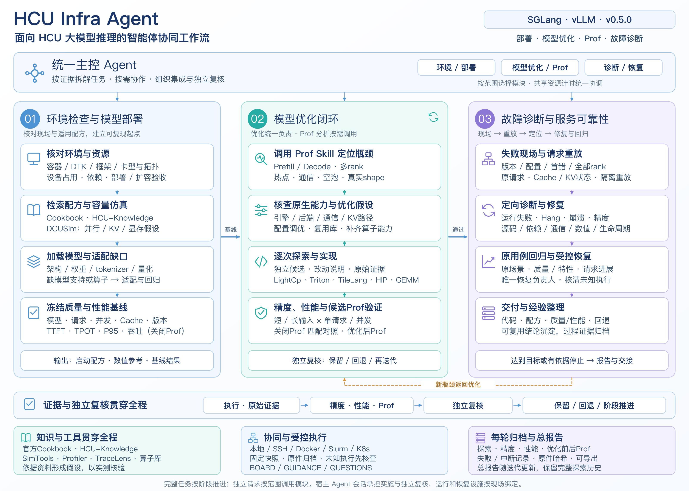
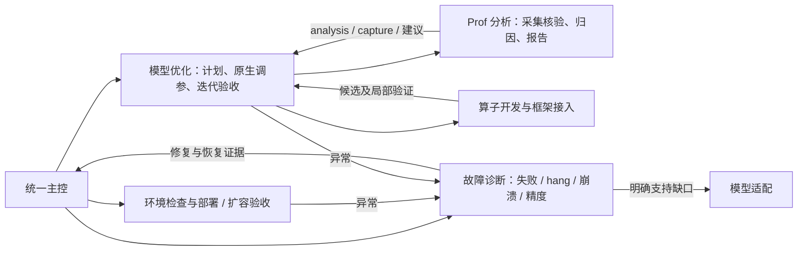

# 架构

用户目标和部署范围 → 本地主控 Agent → 三阶段 Skill → JSON CLI → Store / Flow / Team / Execution → 远端引擎与工具。
执行产生的日志、trace 和请求结果经哈希保存在任务 Store，分析、质量与性能报告绑定 context 和候选 snapshot，review 后推进。

总览图展示任务推进和横向能力；[模型优化闭环](model-optimization-loop.md)规定每轮精度、性能、优化后 Prof 与统一报告的门槛。[图源与再生成](assets/README.md)保留可编辑来源。

## 实现归属

`core.py` 是 SQLite 状态和内容寻址对象，`flow.py` 是持久 review 循环，`team.py` 管理依赖/领取/消息。
`execution.py`、`command_group.py` 保留 TrainFlow 的快照、后端、控制锁与未知执行语义。
`quality.py`、`benchmark.py`、`monitor.py`、`bindings.py` 是推理领域实现；`experience.py` 只导出私有任务摘要。
`analysis.py` 提供通用 profile 证据分析；原生 TraceLens 和高级 profiler 通过明确的外部命令卡与所绑定 Skill 执行。

CLI 不启动隐藏 LLM。宿主提供实际 Agent 会话和独立 review，任务登记与 assignment-bind 不证明模型已经运行。
队列投递、推理运行设施、真实资源隔离是不同职责；Python 租约不是 GPU 调度器或文件系统沙箱。

## 范围与复现

公共仓只保存通用代码、推理 Skill、示例和来源目录。私有 `.work` 保存模型身份、请求、日志、trace、产物及事件。
外部权重、知识库和参考源码只读；新候选在任务专属目录开发。正常步骤沿用既有授权，外部写入核对精确范围。
`HCU_INFRA_WORKSPACE` 只指定私有 Store；Skill 安装记录 `workspace.json.project_root`，不能混作任务工作区。

任务上下文变化会回到 prepared，旧 report 保留但不能推进新任务；相同 context 字节重新出现也有 epoch 隔离。
操作超时或控制器退出可能留下远端进程，应先 reconcile，再决定后续动作。恢复仅由显式 recovery_owner 执行。

## 实际站点文件系统限制

共享目录可能位于 NFS。并发回归在此目录的 SQLite WAL Store 上出现等待并被主动中断；
因此不把 NFS 上的单进程 demo 成功外推为并发控制已验收。运行中的控制 Store 应选用节点/容器本地文件系统，
用明确的 `--workspace` 或 `HCU_INFRA_WORKSPACE` 指定；源码、导出证据和交付日志可保存共享盘。
容器本地目录须登记为任务专用，考虑其生命周期及备份；不能把各节点独立 Store 当作同一个协调数据库。
回归使用任务专属的节点本地临时根，不修改系统账户或其他服务。

## 专业模块

`operators.py` 由 profile 或适配缺口选择专项 skill，通过已有命令执行层调用 runner 并应用/验证/回退框架 adapter。`model_adaptation.py` 维护发布锁、架构缺口和执行测试矩阵，验收后返回可重新建立基线。`model_loop.py` 在 SQLite 中保存带修订号的循环状态，区分初始 oracle、当前最佳与待复核候选；逐轮生成私有报告。

三者是阶段使用的专业能力，宿主 Agent 根据返回的 next/skill 实施工作。它们不替代原有 flow 的实际独立复核，也不自带隐藏 LLM、GPU 调度器或任意模型的通用 kernel。外部 runner、框架 adapter 和测量命令需由 Agent 按当前环境提供并验证；自动接入的对象是已准备的候选与 adapter。

## Skill 职责与运行时路由

保留单主控和部署、优化、服务可靠性三个阶段；`fault-tolerance` 状态/API 名及旧 `operate` 的入口兼容原合同；健康观测/扩容在进入故障 Skill 后交回主控/部署，实际异常才执行诊断。优化阶段 `STAGE_SKILLS.optimize` 统一指向模型优化 Skill；`analyze` 独立模式显式指向 Prof 分析，模型循环的 native 与 plan-and-implement 返回模型优化，capture 步骤返回 Prof 分析。安装清单去重后仍包含十个 Skill（含安装入口）。

Prof Skill 不执行优化计划或候选验收；模型优化按热点读取分模块 references。故障 Skill 从请求与首错出发，修复后返回原任务验收。服务观察由主控使用现有 observe/outbox 协调，异常转故障诊断；扩容配方交部署，故障诊断与扩容职责分别路由。
